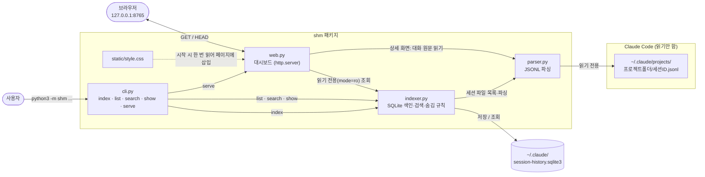
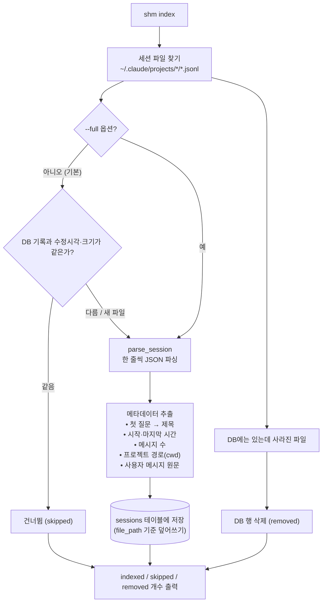
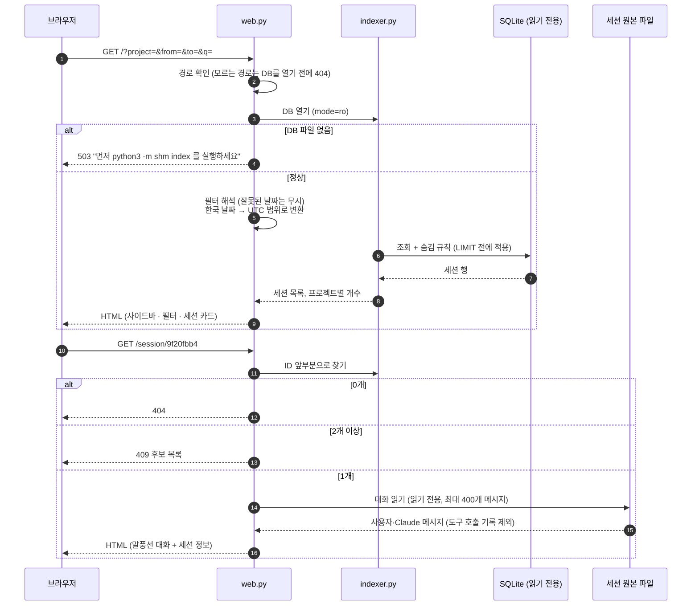
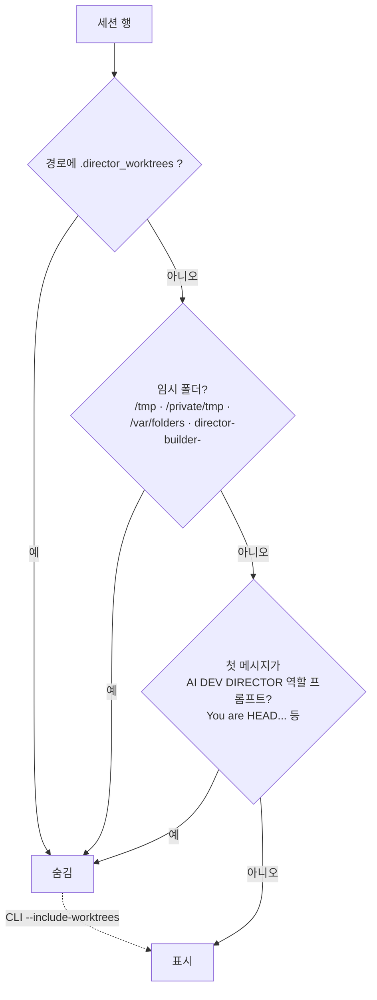

# 흐름 다이어그램

Session History Manager의 데이터 흐름과 요청 처리 순서입니다. 사용법은 [README](../README.md)를 보세요.

## 1. 전체 구조

## 2. 색인 (`python3 -m shm index`)

## 3. 대시보드 요청 처리 (`python3 -m shm serve`)

## 4. 숨김 규칙

목록·검색·상세·API·프로젝트 사이드바에 모두 같은 SQL 조건이 적용됩니다 (`indexer.py`의 `_WORKTREE_EXCLUDE_SQL`).

## 5. 안전 장치 요약

| 위치 | 장치 |
|---|---|
| 세션 원본 파일 | 읽기만 함. 색인과 대시보드 모두 쓰기 없음 |
| 색인 DB | 대시보드는 `mode=ro`로 열고, 색인 갱신은 `shm index`에서만 |
| 서버 주소 | 루프백(`127.0.0.1`, `localhost`, `::1`)만 허용 |
| HTTP 메서드 | `GET`, `HEAD`만 허용 |
| 출력 | 모든 값 HTML 이스케이프, 외부 리소스 참조 없음 |
